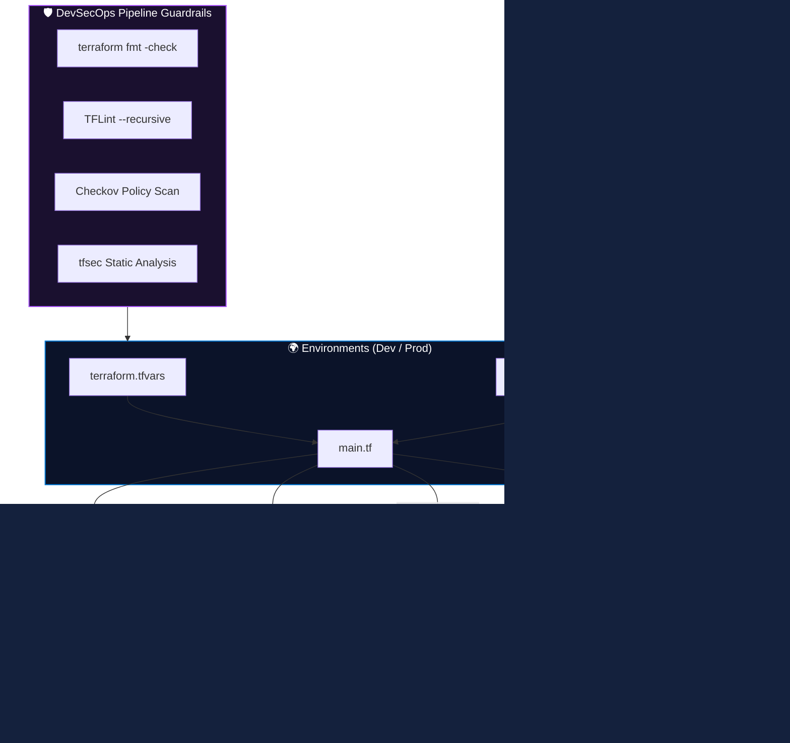

<div align="center">

# 🏛️ Terraform Azure Foundation

### Enterprise Modular Infrastructure as Code (IaC) Framework for Microsoft Azure

<p align="center">
  
  
  
  
  
  
</p>

</div>

---

## 📌 Executive Overview

**Terraform Azure Foundation** is an enterprise-grade Infrastructure as Code (IaC) repository built to provision standardized, secure, and repeatable Microsoft Azure infrastructure components.

Designed around modular architecture best practices and Azure Landing Zone principles, this project demonstrates:
- **Hierarchical Module Separation:** Fully decoupled root and child modules for Resource Groups, Storage Accounts, Virtual Networks, Subnets, and Key Vault.
- **Multi-Environment Isolation:** Independent state hierarchies for `dev` and `prod` with environment-specific variable sets.
- **DevSecOps Shift-Left Security:** Automated pre-flight linting (**TFLint**), syntax validation, and static security policy scanning (**Checkov** & **tfsec**) via GitHub Actions.
- **Zero-Trust Access Baselines:** Private endpoints, Key Vault soft-delete and purge protection, strict network ACLs, and RBAC least-privilege configurations.

---

## 🏗️ Architecture Design & Dependency Flow



---

## 📂 Repository Structure

```text
terraform-azure-foundation/
├── .github/
│   └── workflows/
│       └── terraform-ci.yml         # Automated GitHub Actions DevSecOps CI Pipeline
├── docs/
│   ├── architecture/                # Design decision records & dependency graphs
│   ├── diagrams/                    # Architectural visual diagrams
│   └── screenshots/                 # Deployment verification & plan evidence
├── environments/
│   ├── dev/                         # Development environment configuration
│   │   ├── main.tf
│   │   ├── variables.tf
│   │   ├── locals.tf
│   │   ├── terraform.tfvars
│   │   └── versions.tf
│   └── prod/                        # Production environment configuration (High Availability)
│       ├── main.tf
│       ├── variables.tf
│       ├── terraform.tfvars
│       └── versions.tf
├── modules/
│   ├── resource_group/              # Standardized resource group management
│   │   ├── main.tf
│   │   ├── variables.tf
│   │   └── outputs.tf
│   ├── storage_account/             # Secure storage accounts with TLS & encryption
│   │   ├── main.tf
│   │   ├── variables.tf
│   │   └── outputs.tf
│   ├── virtual_network/             # Hub-and-Spoke VNets & Subnet segmentation
│   │   ├── main.tf
│   │   ├── variables.tf
│   │   └── outputs.tf
│   └── key_vault/                   # Azure Key Vault with Zero-Trust network ACLs
│       ├── main.tf
│       ├── variables.tf
│       └── outputs.tf
├── README.md
├── LICENSE
└── .gitignore
```

---

## 🧰 Implemented Modules & Capabilities

| Module | Directory | Capabilities & Security Guardrails | Status |
| :--- | :--- | :--- | :---: |
| **Resource Group** | `modules/resource_group` | Multi-RG deployment via `for_each`, input validation, standardized tags | ✅ Completed |
| **Storage Account** | `modules/storage_account` | Minimum TLS 1.2, encryption-at-rest, blob versioning, explicit/implicit dependency patterns | ✅ Completed |
| **Virtual Network** | `modules/virtual_network` | Dynamic subnet allocation, address prefix validation, network isolation | ✅ Completed |
| **Key Vault** | `modules/key_vault` | Hardware-backed secrets, soft-delete, purge protection, default `Deny` network ACLs | ✅ Completed |

---

## 🛡️ DevSecOps CI/CD Pipeline

Every Pull Request and commit triggers an automated validation pipeline configured in [`.github/workflows/terraform-ci.yml`](.github/workflows/terraform-ci.yml):

1. **Format Validation:** `terraform fmt -check -recursive` ensures uniform syntax across all modules.
2. **Configuration Quality:** `tflint --recursive` catches cloud-provider deprecated attributes, uninitialized inputs, and syntax errors.
3. **Static Security Analysis (SAST):**
   * **Checkov:** Scans Terraform code against CIS Azure Benchmarks, flagging unencrypted volumes, open NSGs, or public blob access.
   * **tfsec:** Deep AST security analysis preventing infrastructure misconfigurations prior to merge.
4. **Environment Initialization:** Matrix validation testing clean `terraform init -backend=false` and `terraform validate` across `dev` and `prod`.

---

## 🚀 Quickstart Guide

### Prerequisites
* Terraform `>= 1.5.0`
* Azure CLI (`az login`) with an active subscription
* TFLint & Checkov (optional for local pre-commit checks)

### Deploying Development Environment

```bash
# 1. Navigate to target environment
cd environments/dev

# 2. Initialize Terraform modules
terraform init

# 3. Review speculative execution plan
terraform plan -var-file="terraform.tfvars"

# 4. Apply infrastructure changes
terraform apply -var-file="terraform.tfvars"
```

### Deploying Production Environment

```bash
cd environments/prod
terraform init
terraform plan -var-file="terraform.tfvars"
terraform apply -var-file="terraform.tfvars"
```

---

## 📄 License

This project is licensed under the **MIT License** - see the [LICENSE](LICENSE) file for details.
